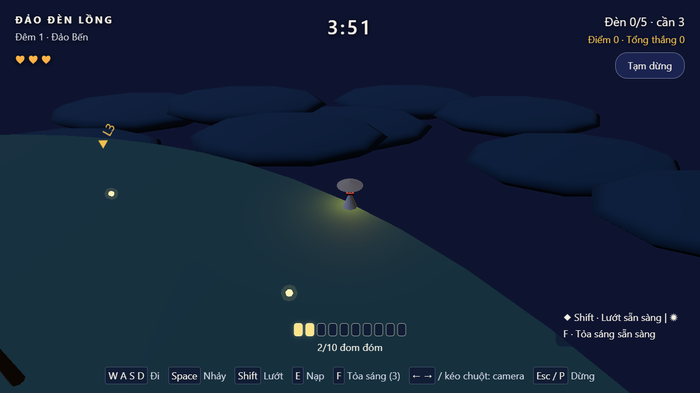

[Video demo MP4](docs/demo/demo.mp4) · [Chơi trên Vercel](https://gamedemo-xi.vercel.app/) · [Release v1.0.0](https://github.com/NguyenDacThe/K5-L3A-DAY12-NguyenDacThe-2A202603529-AI-SDLC-Dao-Den-Long/releases/tag/v1.0.0)

# Đảo Đèn Lồng v1.0.0 — Phase4 / Contract1.3

Game web3D qua ba đêm. Mây đội nónlá gom đomđóm, thắp và châm dầu để giữ ít nhất60% sốđèn sáng tới bìnhminh; tránh BóngMực hút dầu và GióLạc cướpđồ. Cần Node.js24.x/npm, Chrome có WebGL và bàn phím/chuột. Web tĩnh chạy Windows/macOS/Linux, không cần key/dịch vụ ngoài.



## Cài và chơi:3lệnh sau khi clone

```sh
npm ci
npm run build
npm start
```

Mở http://localhost:5173, chọn Bắt đầu hành trình. Để xem đúng bảnbuild dùng `npm run preview` thay `npm start`. Release có ZIPweb sẵn: giải nén, chạy `python3 -m http.server 8000` (Windows:`python -m http.server 8000`), mở http://localhost:8000. Không mởindex bằngfile://.

## Điều khiển, luật và điểm

WASDđi, Space nhảy, Shift lướt, E tương tác, F tỏa sáng; mũi tên trái/phải hoặc kéo chuột xoaycamera, P/Esc tạm dừng. Mọi hành động game đổi được ở Cài đặt, phát hiện trùng, có khôi phục mặc định. Có bảng màu dễphânbiệt, giảmchuyểnđộng, chữlớn×1.25 và volume/mousesensitivity lưu giữa cácphiên.

Đêm1/2/3 kéo dài240/270/300giây, cần3/5,4/6,5/7đèn sáng tại tickcuối. Đủ đèn không thắngsớm; hết3ngọnlửa luônthua. Mỗiđèn100dầu, hao1/giây, dưới30mấtvùngantoàn và BóngMực hút thêm5/giây/con. Thắp mới10đốm, thắp lại5, châm1đốm thêm10dầu. Sứcchứa10+2mỗi lầnthắp, tốiđa20. Sốchuẩn đầyđủ ở game.contract.json và đặc tả từngphase.

Điểm:+5/đốmnạp,+100 thắpmới,+40 thắplại,+5/shade trúngpulse (tổng15nếuđangdrain). Thắngbìnhminh nhận50+floor(fuel) mỗiđènsáng và50mỗilửa; không thưởngthờigian. Tổngđiểm chỉ gồm cácđêmđãthắng.

## Bảng xếp hạng và dữ liệu

Sau khi thua hoặc thắngĐêm3, nhập tên3–12chữ/số/_ (cóhỗtrợchữcódấu). Top10 theo điểmgiảm, tie theo thờiđiểmđạt trước; lưu name/score/nights_won/achieved_at/seed. Web lưu localStorage trênđĩacủatrìnhduyệt. ServerNode local đồngbộ thêm `data/leaderboard.json`; khôngcommit dữliệucánhân.

```sh
node scripts/server.mjs --export-leaderboard out.json
```

Lệnh xuất dữliệu chơiqua serverNode local; trên Vercel hoặc ZIPstatic dùng nút Xuất bảng điểm JSON trongmenu đểxuất cùng dữliệu của browser đó. Xóa dữliệutrìnhduyệt sẽ xóa bảngđiểm/settings local; không có backendxếphạngdùngchung.

## Kiểm chứng, headless, benchmark và soak

```sh
npm run verify
node src/headless.mjs --seed 42 --night 1 --ticks 600 --out out.jsonl
npm run bench -- --seed 42 --duration 30 --out bench.json
npm run soak -- --seed 7 --nights 10 --out soak.json
```

Headless60Hz, khôngGPU, hỗtrợ --night1/2/3, --scenario/--inputs/--snapshot-every. Inputs/scenariosai mã2; các lỗi khác mãkhác0. Outputtấtđịnh và cácschema1.0–1.2 cònhiệulực giữ nguyên; Contract1.3 thêm bench_cmd/soak_cmd. `npm test` chỉchạytest, verifycòn tạo bằngchứngPhase4. `node scripts/browser-phase4.mjs` kiểm tra UI và ghi demo (cần Chrome, `npx playwright install ffmpeg` cho bản ghi).

Benchmark mở Chrome1280×720 với200shade wander/100mote/3đènfuel100, khóa các hệgame theoTicket04, camera15s/vòng. Warmup3s, đo30s; côngthứcFPS/p1low/p95 đúngcontract, sceneaudit ởbench.scene.json. CácflagsChrome yêu cầu tắtvsync nhưng RAFkhôngbảođảm tắt được, nên `vsync_off:false`. Không đoRSSChrome chínhxác nên `peak_mem_mb:null`, đúng ngoại lệbảnweb. Chạy thamkhảo không cócửa sổ: đặt BENCH_HEADLESS=1; phép đo chínhthức dùngcửa sổ. Nếu Chrome không được tìmthấy, cài Chrome trước hoặc cài PlaywrightChromium và đặt BROWSER_CHANNEL=chromium.

Soak dùng `--expose-gc`,10đêm cùngtiếntrình. Warmup engine/JIT1200tick trước khi tảiĐêmđầu vàđoRSS; GCđối xứnghai mốc, end sau resetĐêmcuối. Outputdo chạy thật và fail nếucrash hoặcRSS>120%. Kếtquả bench.json/soak.json ởgốcrepo; giới hạn/máyđo ở [bằng chứngPhase4](docs/proof/phase-4/README.md). Chưa chạy hidden tests/máychấm.

## Hosting, bản quyền và quá trình

Vercel projectgamedemo, root `.`, FrameworkOther, npmci/npmrunbuild/outputdist theo vercel.json; Node24.x. Tấtcảassetweb tựchứa trongdist, Three.js ởvendor/three. Không dùngserverghiđĩa trênVercel. `.env*`, `.vercel/`, data vàcôngcụcụcbộ khôngcommit/upload.

Sáng tạo của tôi: biểnmây, sao, vòngsángvùngantoàn, nhạc/hiệuứngtổnghợp vàcutaway tầnggiữanhânvậtbịche. Cácphầntrangtríbổsung tắt trongbenchmark, không tạo thực thểheadless. [CREDITS](CREDITS.md) · [LICENSE](LICENSE) · [Changelog4phase](CHANGELOG.md) · [Retro](docs/retro.md) · [Ghi chúPhase4](docs/notes/phase-4.md).

Các tagphase-1/2/3 giữ nguyên. Phase4 chốtphase-4 vàv1.0.0, cóMP4 vàZIPweb trênGitHubRelease. Phầnlabgốc giữ bên dưới.

---

# Day 12 — AI SDLC: Đảo Đèn Lồng (tài liệu lab)

> **Cá nhân** (1 người / 1 MSSV) · Áp dụng SDLC cùng AI để xây một **game 3D** qua **4 phase**, từ yêu cầu ban đầu tới bản phát hành.
> **Lab board + trợ giảng:** **[Đảo Đèn Lồng Lab](https://claude.ai/artifact/Q1RYyv1dxjUczzCbd2ZnoW)**

---

## Tài liệu của lab

| File | Nội dung |
|---|---|
| [GUIDE.md](GUIDE.md) | Hướng dẫn làm lab: vòng làm việc mỗi phase, harness, kiểm chứng, token |
| [CHECKPOINTS.md](CHECKPOINTS.md) | Các mốc tự kiểm tra từ chuẩn bị đến nộp bài |
| [SUBMISSION.md](SUBMISSION.md) | Đặt tên repo, hạn nộp, tag, Release, video, checklist |
| [RULES.md](RULES.md) | Quy định: AI, trung thực về bằng chứng, bản quyền, bảo mật |
| [RUBRIC.md](RUBRIC.md) | Thang điểm chi tiết |

## Lab board

Yêu cầu dự án được phát hành tại **[Đảo Đèn Lồng Lab](https://claude.ai/artifact/Q1RYyv1dxjUczzCbd2ZnoW)**. Mỗi phase là một tab (tab chưa phát hành bị khóa), mỗi tab có trợ giảng AI riêng chỉ trả lời trong phạm vi phase đó. Trợ giảng cần đăng nhập claude.ai và dùng lượt Claude của bạn.

## Dự án

**Đảo Đèn Lồng**: game 3D góc nhìn thứ ba. Mây, người giữ đèn nhỏ tuổi, gom đom đóm để thắp lại các Đèn Lồng Lớn và né Bóng Mực trong sương đen.

- Không ràng buộc công nghệ; chạy được trên macOS hoặc Linux.
- Tuân theo **Test Contract** (chế độ headless) để được chấm tự động và so sánh với nhau.

| Phase | Bạn nhận | Nộp |
|---|---|---|
| 1 | **PRD-0** (mô tả tổng quát) + Test Contract | tag `phase-1` |
| 2 | **Ticket-02**, phát hành khi Phase 1 kết thúc | tag `phase-2` |
| 3 | **Ticket-03**, phát hành khi Phase 2 kết thúc | tag `phase-3` |
| 4 | **Ticket-04**, phát hành khi Phase 3 kết thúc | tag `phase-4` + Release `v1.0.0` |

Yêu cầu sẽ được bổ sung và có thể thay đổi giữa các phase, giống dự án thật.

### Lịch 4 giờ

Bài lab kéo dài **4 giờ**. Phase 1 và 2 khoảng **1 giờ**, Phase 3 khoảng **30 phút**, Phase 4 khoảng **1 giờ 30 phút**. Mỗi phase phát hành đúng mốc giờ. Phase mới xuất hiện trên lab board khi tới mốc.

| Mốc | Sự kiện | Hạn tag |
|---|---|---|
| 0h | Phát hành **Phase 1** (PRD-0), gồm cả phần chuẩn bị | `phase-1` trước mốc 1h |
| 1h | Phát hành **Phase 2** | `phase-2` trước mốc 2h |
| 2h | Phát hành **Phase 3** | `phase-3` trước mốc 2h30 |
| 2h30 | Phát hành **Phase 4** | `phase-4`, Release `v1.0.0` và video trước mốc 4h |
| 4h | Hết giờ lab, chốt bài | |

Hết giờ mỗi phase thì tag và chuyển sang phase tiếp theo, dù phase chưa hoàn hảo. Chỗ chưa xong ghi trung thực trong bằng chứng.

---

## Gợi ý SDLC (cách làm là của bạn)

Mỗi phase là một vòng nhỏ. Công cụ, thứ tự, định dạng tài liệu đều tự do; đây chỉ là gợi ý:

1. **Requirements:** biến yêu cầu thành tiêu chí nghiệm thu kiểm chứng được. Chỗ mơ hồ thì tự giả định và ghi lại.
2. **Plan:** nghĩ cách kiểm chứng **trước** khi để agent viết code.
3. **Build:** để agent viết, bạn điều phối và review.
4. **Verify:** chạy thật, kiểm tra hành vi thật. *Không có bằng chứng thì chưa xong*: "agent bảo chạy rồi" không phải bằng chứng.
5. **Evaluate:** cái gì đạt, AI sai ở đâu, harness (AGENTS.md, skill, hook) cần chỉnh gì.
6. **Release:** gắn tag.

## Ba điều cần nhớ

> Bạn được **tự do sáng tạo thêm** quanh phần lõi (nhân vật, cơ chế nhỏ, câu chuyện, hiệu ứng, âm thanh…). Sáng tạo gọn và không phá yêu cầu được tính điểm trong hạng mục F của [RUBRIC](RUBRIC.md); ghi mục "Sáng tạo của tôi" trong README của bạn.

- **Game tốt là game đúng yêu cầu của khách hàng**, không phải game phức tạp hay đẹp nhất. Làm đúng và chứng minh được là đúng trước, trau chuốt sau.
- **Cân nhắc kỹ quota token của bạn.** Đốt nhiều token không làm bài tốt hơn. Ngữ cảnh gọn, kế hoạch rõ, kiểm chứng sớm thường vừa rẻ vừa đúng hơn chạy agent liên tục.
- **Kiểm chứng là phần quan trọng nhất.** Bằng chứng (test, output headless, ảnh, số đo) đáng giá hơn lời mô tả.

---

## Bàn giao cuối cùng

Một **repo GitHub cá nhân, public**, gồm:

1. **Toàn bộ mã nguồn** của game qua 4 phase, tag `phase-1` … `phase-4`, Release `v1.0.0`.
2. **Video demo `.mp4` dưới 5 phút** (đính kèm Release `v1.0.0` hoặc `docs/demo/demo.mp4`, link ở đầu README): chơi thử và cho thấy bằng chứng game chạy đúng.
3. **Bằng chứng kiểm chứng** của từng phase (định dạng tự chọn).
4. **Harness AI đã dùng** (AGENTS.md / CLAUDE.md, skills, hooks, plugins…), giữ nguyên trong repo và lịch sử git.
5. **Ghi chép ngắn:** spec/giả định mỗi phase, nhật ký dùng AI (gồm token/chi phí ước tính), retro.

Không commit API key, token hay `.env`. Gửi link repo theo hướng dẫn của Coach.

## Đánh giá (100 điểm)

| Hạng mục | Điểm |
|---|---|
| Test tự động ẩn (headless, gồm kiểm tra lại phase trước) | 30 |
| Kiểm chứng & bằng chứng của bạn | 20 |
| Quy trình SDLC & harness AI | 15 |
| Evaluation & retro (gồm cách bạn dùng token) | 10 |
| Hiệu năng & ổn định | 10 |
| Chất lượng sản phẩm (đúng yêu cầu, chơi được) | 10 |
| Video demo | 5 |

## Quy định

- Dùng AI thoải mái; không sao chép repo của người khác.
- Bằng chứng phải thật: test luôn đạt hay output sửa tay là vi phạm.
- Nhân vật, bối cảnh là bản gốc của lab; asset bên ngoài chỉ dùng loại CC0/CC-BY/MIT hoặc tự tạo, ghi nguồn trong `CREDITS.md`.
